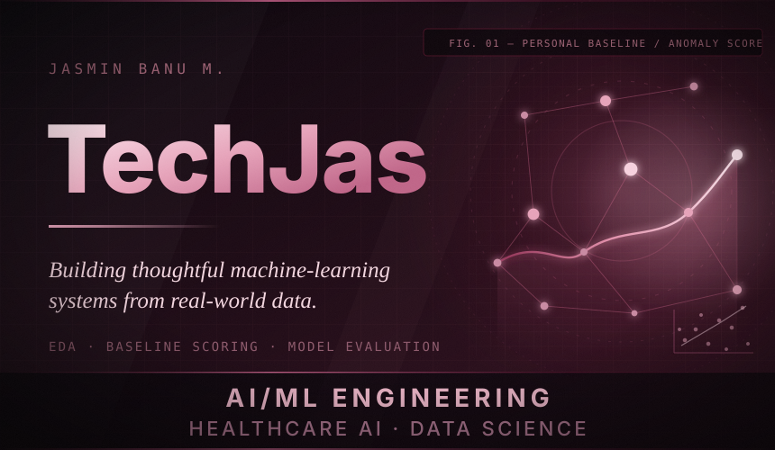

**Jasmin Banu M.** — B.Tech Artificial Intelligence & Data Science · CGPA 9.80/10 · Chennai, India
 
<a href="https://linkedin.com/in/jasminbanu-tech"><strong>LinkedIn</strong></a> &nbsp;·&nbsp; <a href="https://github.com/TechJas"><strong>GitHub</strong></a> &nbsp;·&nbsp; <a href="mailto:jasmin03banu@gmail.com"><strong>Email</strong></a>

---

> **I build machine-learning systems that begin with a question someone actually asked** — and then publish the reasoning behind the result, including the parts that did not work.

Right now that means three kinds of problem:

- **Longitudinal health data** — where a person's own history says more than a population reference range, and where *interesting* is not the same as *actionable*.
- **Operational value chains** — where a model has to survive contact with messy, multi-source, partly incomplete reality.
- **Tabular classification at scale** — where evaluation discipline matters more than model novelty.

**Portfolio at a glance** — 3 featured case studies · 5 supporting repositories · 3 live Streamlit apps · 1 Kaggle Playground competition · 1 NASA open dataset

---

## The through-line

Every project below follows the same arc. That is not a coincidence — it is the method.

| Curiosity | Data | Investigation | Experiments | Evidence | Useful tools |
|:--|:--|:--|:--|:--|:--|
| What question is actually worth answering? | Raw CSVs from NASA, Kaggle and agricultural supply chains | Distributions, correlations, outliers, missingness, class balance | Personal baselines, z-scores, Logistic Regression, KNN, Random Forest, hyper-parameter grids | Cross-validation, walk-forward validation, precision / recall / F1, ROC-AUC, MAE & RMSE | Streamlit apps, reproducible scripts, notebooks, version control |

---

## Featured work

### I — AstroHealth

NASA Inspiration4 · Longitudinal biomarker anomaly analysis · Deployed Streamlit research prototype

**The question.** A lab report tells you whether a value is normal *for people*. Can it also tell you whether it is normal *for this person* — and can the next value be forecast honestly from what came before?

| | |
|:--|:--|
| **Data** | NASA Life Sciences Data Archive — Inspiration4. 4 crew members, 36 analytes (CBC 20 + CMP 16), 7 timepoints, 1,001 measurements |
| **Approach** | EDA & cleaning notebooks → personal baselines → z-score scoring → multi-threshold flags → chronological walk-forward forecast evaluation |
| **Stack** | Python · pandas · NumPy · Plotly · Streamlit |
| **Status** | Research and educational prototype. **Not** a diagnostic tool, and **not** for clinical decision-making. |

**What I built**

- **Personal baselines instead of population averages.** Each participant's three preflight measurements become their own mean and standard deviation, and every postflight value is scored as `z = (value − personal mean) ÷ personal SD`. The dashboard shows the personal baseline band *and* the population reference range side by side, because they disagree — and that disagreement is the interesting part.
- **Threshold sensitivity rather than one magic cut-off.** Deviations are flagged at `|z| > 2.0`, `2.5` and `3.0`, which flags 132, 93 and 79 measurements respectively. Exposing the trade-off is more honest than shipping a single threshold.
- **Reference-range status kept deliberately separate.** Of 574 scored postflight measurements: 555 within range, 10 above, 8 below, 1 missing. A value can be perfectly normal for the population and still be unusual for the person.
- **Forecasting evaluated chronologically.** Three one-step-ahead baselines — last observed value, historical mean, linear trend — are scored in a walk-forward loop, compared *within each series* against the naive baseline, and summarised with the median so a handful of explosive series cannot distort the result.
- **The result is deliberately modest.** Across 144 series the historical mean reaches 0.83× the naive error and wins on 74% of them; the linear trend lands at 1.16×, i.e. worse than doing nothing, because seven points per analyte cannot support a trend. The repository says so plainly.

**What a reviewer will find**

- The pipeline is scripts, not just notebooks: `scripts/build_dashboard.py` (baselines, z-scores, flags), `scripts/forecast_eval.py` (walk-forward evaluation) and `scripts/smoke_test.py` (render and interaction checks).
- The processed datasets are committed, so every number above can be verified without re-downloading the NASA source data.

**Limits**

- 4 participants and 7 timepoints per analyte — no statistical power for a risk model.
- No outcome labels, so this is not prediction of disease or clinical deterioration.
- Baselines come from only 3 preflight points, so the baseline standard deviation is itself uncertain.
- Forecasting is a feasibility demonstration; the series are too short for reliable prediction intervals.

**[Repository →](https://github.com/TechJas/git-anomaly_detection_pipeline)** &nbsp;·&nbsp; **[Live demo →](https://techjas-git-anomaly-detection-pipeline-app-a5atpx.streamlit.app/)**

---

### II — AgriLoop AI

India's banana value chain · Circular-economy ML platform · Deployed Streamlit application

**The question.** India is the world's largest banana producer, and roughly 30–40% of the crop is lost or wasted between farm and market. Can machine learning make the waste, the route risk and the price gap visible enough for someone to act on?

| | |
|:--|:--|
| **Scope** | Team project — 5 datasets, 12,111 records, 6 analytics modules, 5 trained models |
| **My contribution** | Cleaned the **logistics** (1,500) and **waste-utilisation** (1,979) datasets — 3,479 records — engineered 20+ derived features, and designed and shipped the end-to-end application |
| **Approach** | Cleaning with explicit missing-value flags → derived operational features → scikit-learn models (Linear Regression + Random Forest) → composite circular-economy score → Streamlit + Plotly application |
| **Stack** | Python · pandas · scikit-learn · Plotly · Streamlit · joblib |
| **Status** | Live application. The training notebooks are not published yet, and parts of the pipeline are co-owned with the team. |

**What I built**

- **Cleaning that flags instead of silently dropping.** Nulls become explicit `*_missing_flag` columns, so downstream models can learn from absence rather than inherit a quiet bias.
- **Features that name a real operational quantity.** `cost_per_km`, `delivery_efficiency`, `fiber / compost / paper_efficiency`, `carbon_efficiency` and `profit_per_kg` — derived, not copied from the source tables.
- **Six modules answering six operational questions:** farmer income (Linear Regression), market price, marketplace pricing, logistics spoilage risk and waste-to-value profit (Random Forest each), plus a composite circular score across the whole chain.
- **Serving that cannot silently drift.** The serving path validates every incoming feature frame against each trained model's `feature_names_in_`, and the one-hot and label encodings are pinned in `app/utils/constants.py`. A column-order or encoding mismatch surfaces as an error instead of a wrong prediction.
- **A database-optional data layer.** The app reads the cleaned CSVs first and only falls back to Supabase when a file is missing, so the whole application runs with zero external services.

**Limits**

- This was a group project. I owned the two datasets named above and the application design; other parts of the pipeline are shared.
- The training notebooks are not public yet, so the model-building steps cannot be audited end-to-end from the repository today.
- The models are trained on the project's cleaned agricultural datasets and have not been validated against a live supply chain.
- The "circular score" is a hand-designed composite index, not a learned one — it encodes the team's priorities rather than a discovered truth.

**[Repository →](https://github.com/TechJas/AI_CIRCULAR-ECONOMY)** &nbsp;·&nbsp; **[Live demo →](https://aicircular-economy-2026.streamlit.app/)**

---

### III — EV Purchase Prediction

Kaggle Playground Series S6E9 · Binary classification on 668,665 rows

**The question.** On a 668,665-row customer dataset, does a linear model actually beat a random forest for predicting EV purchase intent — and how would you honestly tell?

| | |
|:--|:--|
| **Data** | Kaggle Playground Series S6E9 — 668,665 training rows × 15 columns (14 features + `Will_Buy_EV`), 0 missing values, 0 duplicate rows; 286,571 test rows |
| **Class balance** | No: 551,886 (82.54%) · Yes: 116,779 (17.46%) — so accuracy on its own would be misleading |
| **Approach** | EDA → outlier *plausibility* analysis → typed preprocessing → `Pipeline` + `ColumnTransformer` → stratified 80/20 split → three models → `GridSearchCV` → Kaggle submission |
| **Stack** | Python · scikit-learn · pandas |
| **Status** | Completed competition entry — Kaggle Playground Competitor badge, September 2026 |

**What I built**

- **Statistical outlier ≠ data error.** IQR bounds were used to *screen* the numeric features, not to delete rows. A long daily commute or a high income is unusual, not invalid — so plausibility rather than the quartile decided what survived.
- **Preprocessing that matches the column type.** `StandardScaler` for 7 numeric features, `OneHotEncoder` for 5 categorical ones and `OrdinalEncoder` for `Range_Anxiety_Level`, all wired through a `ColumnTransformer` so exactly the same transformation runs at training and inference time.
- **A split that respects the imbalance.** 80/20 with `random_state=42` and `stratify=y`, so the 17.46% positive class is preserved in both halves.
- **Three baselines compared on the same footing.** Logistic Regression, KNN (`k = 5`) and Random Forest, all scored on precision, recall and F1 — not accuracy alone.

**Validation results**

| Model | Accuracy | Precision | Recall | F1 |
|:--|--:|--:|--:|--:|
| Logistic Regression | 0.8944 | 0.7150 | 0.6577 | **0.6852** |
| Random Forest | 0.8917 | 0.7086 | 0.6453 | 0.6755 |
| KNN | 0.8784 | 0.6627 | 0.6186 | 0.6399 |

- **Tuning changed almost nothing.** `GridSearchCV` over `C ∈ {0.01, 0.1, 1, 10, 100}` with 5-fold cross-validation and `refit="f1"` selected `C = 10` (CV F1 0.6846). The tuned model scored accuracy 0.8944, precision 0.7150, recall 0.6575, F1 0.6851 and ROC-AUC 0.9374.
- **The most useful result is not the leaderboard.** The simplest model won. With sensible encoding and scaling, Logistic Regression matched a random forest on accuracy and edged it on F1 — worth more attention than a four-decimal leaderboard number.
- **Kaggle scores** (competition metric, *not* validation accuracy): public leaderboard 0.93673, private leaderboard 0.93627. The small gap between them is reassuring, but a leaderboard score is not a generalisation estimate.

**Limits**

- Playground Series data is generated rather than collected, so behaviour here may not transfer to real customers.
- A single stratified split rather than repeated or nested cross-validation.
- No calibration analysis, no decision-threshold study, and no error analysis of individual false positives and negatives yet.
- ROC-AUC of 0.9374 sits far above an F1 of 0.6851: the models rank the positive class well and still miss roughly a third of it — which is exactly where a threshold decision would start to matter.

**[Repository →](https://github.com/TechJas/EV-prediction-Kaggle)** &nbsp;·&nbsp; **[Competition →](https://www.kaggle.com/competitions/playground-series-s6e9)**

---

## More in the lab

Smaller repositories, but each one is a complete piece of work.

| Project | What it does | Stack |
|:--|:--|:--|
| [Heart Disease Prediction](https://github.com/TechJas/Heart-Disease-Mini-Prediction-Model-) | Random Forest over 8 clinical features — including troponin and CK-MB — from 1,319 patient records. Outliers are retained where they are clinically meaningful, and the model is tuned with `GridSearchCV` and 5-fold stratified cross-validation: 98.47% test F1, with troponin (~57%) and CK-MB (~26%) dominating the feature importance. Shipped as a Streamlit app — [live demo →](https://heart-disease-mini-prediction-model.streamlit.app). | Python · scikit-learn · Streamlit · joblib |
| [Breast Tumor Prediction](https://github.com/TechJas/Prediction-The-Tumor) | Random Forest over 13 selected features of the UCI Wisconsin breast-cancer dataset (569 samples). Stratified split and scaling, a precision / recall / F1 report (malignant recall 0.90 against benign 1.00), class boxplots, a correlation heatmap, feature-importance ranking, and an upload-a-file-and-predict mode. | Python · pandas · scikit-learn · Matplotlib · Seaborn |
| [Alzheimer's Disease Analysis](https://github.com/TechJas/Alzhemeir-Disease-Analysis) | 2,149 records of clinical, cognitive and functional assessment data. Logistic Regression, Decision Tree and Random Forest, with `class_weight='balanced'` and threshold tuning aimed at protecting recall, plus derived features such as pulse pressure and a cardiovascular risk score. The dataset is synthetic, and the repository says so. | Python · pandas · scikit-learn |
| [Patient Diabetes Analysis](https://github.com/TechJas/Patient-Diabetes-Analysis) | A pandas fundamentals notebook: correlation analysis on small inline patient tables and — more usefully — a written note on why a 6-row dataset produces a correlation of 0.99, and why that number means nothing. | Python · pandas · NumPy |
| [Amazon Sales Dashboard](https://github.com/TechJas/Sales-Dashboard) | A Power BI report over multi-year Amazon sales data — total sales, profit and quantity KPI cards, sales trends by year, quarter, month and day, profit contribution by state, and category-level breakdowns, built with DAX measures. | Power BI · DAX · Excel / CSV |

---

## The toolkit

Only what the repositories above actually use.

| Layer | Tools |
|:--|:--|
| **Programming & data** | Python · SQL · pandas · NumPy |
| **Machine learning** | scikit-learn · Logistic Regression · KNN · Random Forest · feature engineering · class weighting & threshold tuning · cross-validation (5-fold, stratified) · `GridSearchCV` · evaluation by precision, recall, F1, ROC-AUC, MAE & RMSE |
| **Visualisation & apps** | Streamlit · Plotly · Matplotlib · Seaborn · Power BI · DAX |
| **Workflow** | Jupyter Notebook · Git · GitHub · Kaggle · exploratory data analysis · Excel / CSV |

### How I work

1. **Start from the operational question, not the dataset.** Every project above began as a question a domain expert would actually ask — is this value normal *for this person*? where does the crop spoil? does the simple model beat the complex one?
2. **Separate "statistically unusual" from "wrong".** IQR outliers are screened, not deleted; extreme troponin values are kept because they are the signal.
3. **Always compare against a baseline.** A forecast must beat the last observed value, a classifier must beat a trivial one, and a score must be read against the metric it actually uses. When a model cannot beat the naive baseline, the repository says so.
4. **Publish the limits with the result.** Every featured project ends with what the data cannot support. A number without its constraints is marketing, not evidence.

---

## Background

**B.Tech, Artificial Intelligence & Data Science** — Mohamed Sathak A.J. College of Engineering, Chennai · 2024 – 2028 (expected)
**CGPA 9.80 / 10**

| Role | Organisation | Period | Focus |
|:--|:--|:--|:--|
| Technology Co-Lead & Developer | Carenium — healthcare platform startup | Apr – Sep 2026 | Owned system workflows and feature planning for a platform connecting patients, nurses and doctors; drove UI/UX improvements and coordinated technical work across the team. |
| Junior Machine Learning Data Analyst Intern (remote) | YuvaIntern | Jul – Aug 2026 | Framed an agribusiness ML use case from the business side — problem framing, data assessment, cleaning, feature engineering and leakage prevention — and communicated the strategy in technical reports. |
| UI/UX Intern | Zaalima Development Pvt Ltd | Jan – Apr 2026 | Assisted with dashboard and interface design, and structured data to improve usability. |
| Web Development Intern | Farm to Hand | — | Contributed to application workflow improvements and interaction design. |

**Certifications** — IBM Developer Skills Network: SQL Fundamentals · Python for Data Science · Prompt Engineering
**Leadership** — Team Lead, Developer Team (MSAJCE)

---

## Let's talk

**Open to Machine Learning / AI Engineer internships and applied ML roles — Chennai, India, or remote.**

<a href="https://linkedin.com/in/jasminbanu-tech"><strong>LinkedIn</strong></a> &nbsp;·&nbsp; <a href="https://github.com/TechJas"><strong>GitHub</strong></a> &nbsp;·&nbsp; <a href="mailto:jasmin03banu@gmail.com"><strong>Email</strong></a>

---

Every figure quoted above is taken from the committed data, scripts or notebooks in the linked repositories. Health-related projects are educational prototypes and are not medical devices. <a href="https://github.com/TechJas">TechJas</a> · 2026
