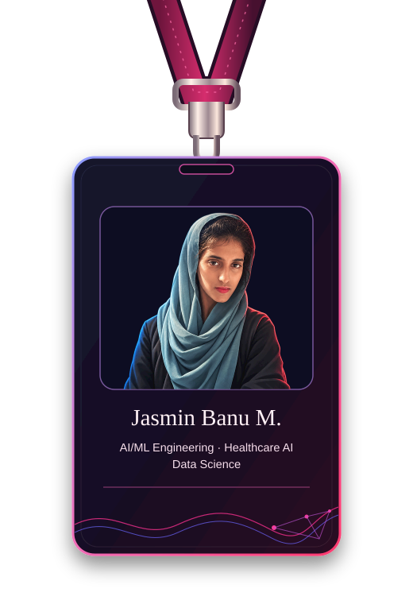
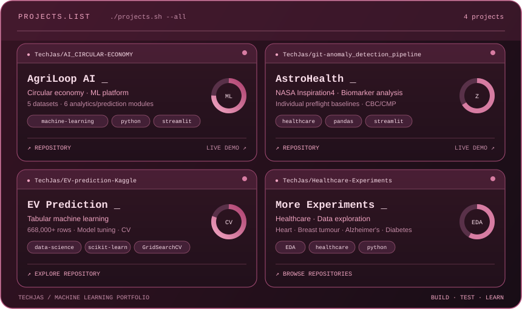
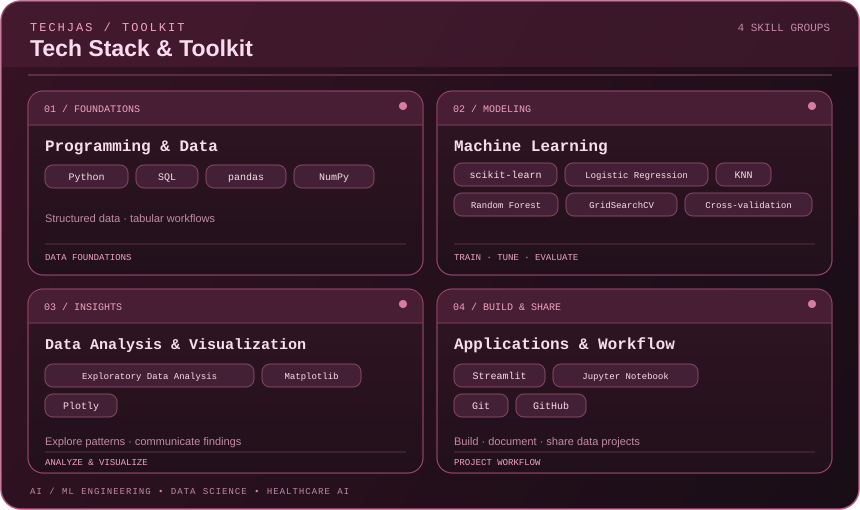

# Jasmin Banu M. | AI/ML Engineering

  

<h3 align="center">AI/ML Engineering · Healthcare Data · Applied Machine Learning</h3>

  Building practical machine-learning projects from real-world data.

  <a href="https://linkedin.com/in/jasminbanu-tech">LinkedIn</a> •
  <a href="https://github.com/TechJas">GitHub</a> •
  <a href="mailto:jasmin03banu@gmail.com">Email</a>

---

## The story behind my work

I'm an undergraduate B.Tech Artificial Intelligence and Data Science student building practical machine-learning projects from real-world data.

My interests span **machine learning, healthcare analytics, and data-driven applications**. I enjoy exploring datasets, understanding feature behaviour, comparing models, and turning analytical results into interactive tools.

**Currently focused on:** exploratory data analysis, reliable evaluation, data leakage prevention, and reproducible ML workflows.

---

## 🚀 Featured Projects

  

---

## Tech Stack and Toolkit

  

  <em>Currently strengthening data quality analysis, feature engineering, data leakage prevention, model evaluation, and reproducible ML workflows.</em>

---

## 🔬 How I Approach a Project

  <b>Question</b> → <b>Explore</b> → <b>Prepare</b> → <b>Experiment</b> → <b>Evaluate</b> → <b>Communicate</b>

I start by understanding the problem before choosing a model. I investigate data quality, examine meaningful features, select appropriate evaluation methods, and communicate limitations alongside results.

For me, a model score is only part of the story. Understanding how that result was obtained matters just as much.

---

## 🤝 Let's Connect

I'm interested in connecting with AI/ML practitioners, data scientists, researchers, and teams working on meaningful data-driven problems.

  <a href="https://linkedin.com/in/jasminbanu-tech">LinkedIn</a> ·
  <a href="https://github.com/TechJas">GitHub</a> ·
  <a href="mailto:jasmin03banu@gmail.com">Email</a>

  <i>Curious about the data. Careful about the evidence. Always learning.</i>

